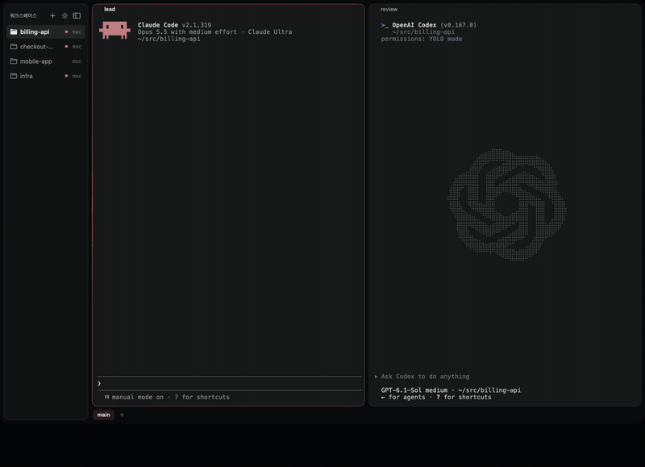

# peer

코딩 에이전트끼리 이름으로 말을 주고받게 해 주는 도구예요.

<a href="assets/peer-demo-ko.mp4"></a>

<sub>실제 Claude Code와 Codex, 38초. 누르면 전체 영상이 열려요.</sub>

```
$ peer say work-review "인증 리팩터링 끝났어, src/auth.ts 봐 줘"
delivered · claude-native · laptop/3f9c…
```

답은 보낸 에이전트의 대화에 `[from work-review@laptop] …`로 들어와요.

## 왜 만들었나

Claude Code와 Codex를 여러 개 띄워 같이 일을 시키다 보면, 서로 말을 걸게 하는 방법이 보통 상대 터미널에 대신 치는 스크립트예요. 화면을 읽고, 붙여넣고, 들어갔는지 보고, Enter를 눌러요. 단계마다 사고가 납니다. Enter가 승인 화면에 들어가서 사람 대신 답해 버리거나, 사람이 쓰다 둔 글 뒤에 메시지가 붙거나, 붙여넣은 글이 제출되지 않은 채 몇 시간 묻히기도 해요.

peer는 터미널에 치지 않아요. 각 엔진이 원래 가진 입력 길로 넘겨요.

- **Claude Code**: Claude끼리 쓰는 내장 받은편지함으로 넘겨요. `SendMessage` 도구가 쓰는 바로 그 길이에요. 떠 있는 세션이면 쉬든 일하든 다시 띄우지 않고 닿아요.
- **Codex**: app-server의 `turn/start`·`turn/steer`로 넘겨요. `peer run codex`로 띄운 세션이 대상이에요.

그래서 보내기는 명령 한 줄이에요. 상대가 지금 일하는 중인지(`working`), 사람 승인을 기다리는지(`blocked`), 쉬는지(`idle`), 누구 답을 기다리는지(`waiting-on`)가 화면을 읽지 않아도 보여요. 들어갔는지도 같은 줄에 나와요.

## 설치

Claude Code나 Codex에 이 한 줄을 붙여넣고 에이전트에게 맡기세요.

```
peer 설정해 줘: curl -fsSL https://raw.githubusercontent.com/oesoll/peer/main/SETUP.md 를 읽고 그대로 진행해.
```

에이전트가 설치하고, 점검하고, 아래 두 가지를 물어본 뒤, 메시지가 실제로 들어가는 걸 보여 줘요.

직접 할 때는 이렇게 해요.

```sh
curl -fsSL https://raw.githubusercontent.com/oesoll/peer/main/install.sh | sh
                                # ~/.local/share/peer에 받고, ~/.local/bin/peer 링크, 훅, 에이전트 스킬
peer install --accept-inbound --codex-alias
                                # 추천: 쉬는 Claude도 바로 받고, 평소 치는 `codex`가 받을 수 있는 세션으로 떠요
peer doctor                     # 되는 것, 빠진 것, 채우는 명령
```

Python 3.9 이상이면 돼요. tmux가 있으면 `peer spawn`과 가까운 순 목록도 써요. sm 세션 층이 peer 옆에 깔려 있으면 `peer spawn`은 tmux 대신 sm으로 띄워요. 설치 뒤 Codex에서 `/hooks`로 새 훅을 한 번 신뢰해 주세요.

- `--accept-inbound`: 없으면 쉬는 Claude에게 보낸 메시지는 그 세션의 다음 턴까지 기다려요(아래 설명).
- `--codex-alias`: 셸 설정에 `alias codex='peer run codex'`를 넣어요. Codex는 peer를 거쳐 띄운 세션만 받을 수 있는데, 이 별칭이 평소 치는 `codex`를 그 세션으로 만들어요. `codex exec`, `codex login` 같은 비대화형 명령은 그대로 Codex를 실행해요.

이미 떠 있던 세션은 다음 턴부터 목록에 나타나요.

## 쓰기

에이전트는 함께 깔리는 스킬로 쓰는 법을 배워요. 사람이 직접 써 볼 때는 이렇게 해요.

```sh
peer                               # 내 근처: 같은 tmux 세션 → 비슷한 폴더 → 최근에 말한 상대
peer say 이름 "글"                  # delivered, 아니면 queued/held와 무엇을 기다리는지, 고치는 법
peer ask 이름 "질문"                # 최대 60초 기다렸다가 답을 출력
peer read 이름 --last 2             # 화면 말고 엔진 대화 기록에서 마지막 답
peer spawn reviewer --kind codex   # tmux(또는 sm)에 띄우고 준비되면 돌아옴
peer name reviewer                 # 이 세션 이름 바꾸기(재개해도 유지)
```

이름은 tmux 세션과 패널 라벨에서 지어요. `tmux set -p @peer review`를 해 두면 `work-review`가 돼요. 라벨이 없으면 폴더와 엔진 이름을 써요. Fine 탭은 한 번, 탭 제목으로 이름을 지어요. 사람 승인을 기다리는 상대에게 보낸 메시지는 들고 있다가, 풀리면 넣어요.

메시지를 받은 에이전트의 턴이 실패하면(rate limit, 과부하, API 오류) peer가 보낸 쪽에 이유를 알려 줘요. 오지 않을 답을 계속 기다리지 않게요. `peer` 목록에도 `error` 옆에 이유가 나와요.

같은 이름의 종료된 세션과 살아 있는 세션 하나가 있으면 살아 있는 쪽으로 보내요. `peer --all --json`에 나온 `id`(`claude:<세션 ID>` 등)나 세션 ID로 직접 지정할 수도 있어요. 뒤에 `@HOST`를 붙이면 기기도 고를 수 있어요. 살아 있는 동명이 여럿이면 하나를 지정해야 해요.

이미 등록된 Claude 세션을 재개하면 다음 훅을 기다리지 않고 Claude의 세션 파일에서 다시 찾아요. 처음 보는 세션은 훅으로 등록해야 해요. 수신자의 peer 기록이 삭제되면 아직 보내지 못한 메시지는 `failed` 영수증을 남기고 정리해요. peer를 업데이트할 때도 대기 중인 메시지는 새 코드로 실행한 배달 프로세스에 자동으로 넘겨요.

### 다른 기기

```json
// ~/.config/peer/hosts.json
{ "server": { "ssh": "me@server" } }
```

그 기기에 있는 상대에게는 `ssh me@server ~/.local/bin/peer _rpc …`로 전해요. 요청은 stdin으로 가요. 그쪽에도 같은 버전의 peer를 깔고, 답이 돌아오게 그쪽 hosts.json에도 이 기기를 적어 주세요.

ssh 로그인을 받지 않는 기기(원격 로그인을 끈 노트북)는 대신 허브로 나가는 터널을 열어 둬요. 허브는 sshd가 있고 양쪽이 닿는 아무 기기면 돼요. 터널로 오가는 요청은 내 기기들만 가진 키로 서명해서, 허브가 명령을 넣거나 답을 꾸밀 수 없어요. 허브 뒤의 기기마다 이렇게 적어요.

```json
// ~/.config/peer/relay.json   (ssh_alias: ~/.ssh/config의 Host)
{ "name": "home", "ssh_alias": "hub", "remote_dir": "/home/me/.peer-relay" }
```

한 기기에서 `peer relay keygen`을 하고 `~/.config/peer/relay.key`(권한 600)를 다른 기기들에 복사해요. 허브에는 두지 마세요. 그다음 기기마다 `peer relay install`로 터널을 띄워 둬요. 이렇게 닿는 기기는 hosts.json에 `{ "laptop": { "relay": "home" } }`로 적어요. `peer relay status`가 경로마다 확인해 줘요.

### 내 런처를 쓴다면

```json
// ~/.config/peer/launch.json
{ "claude": ["내-claude-래퍼"], "codex": ["codex"] }
```

## `--accept-inbound`가 하는 일

Claude Code는 보낸 쪽이 같은 권한 모드로 도는 Claude 세션이라고 확인될 때만 메시지를 묻지 않고 받아요. peer의 배달 프로세스는 Claude 세션이 아니라서, 이 설정이 없으면 Claude가 승인 화면을 띄워요. 그래서 peer는 이 설정이 없을 때 그 길을 쓰지 않고, 상대의 다음 도구 호출이나 턴을 기다려요.

`peer install --accept-inbound`는 `~/.claude/settings.json`에 `"crossSessionInbound": "accept"`를 넣어요. 그러면 같은 사용자로 도는 프로세스가 보낸 메시지를 묻지 않고 받아요. 그런 프로세스는 지금도 내 터미널에 칠 수 있으니 새로 열리는 문은 거의 없어요. 그래도 알고 켜세요.

## 한계

- Claude의 내장 받은편지함은 공개 API가 아니에요. peer는 관찰한 프로토콜(`peerProtocol: 1`)을 쓰고, 바뀌면 훅 경로로 물러나요. 그래도 Claude Code 업데이트 때 빠른 길이 깨질 수 있어요.
- Codex는 peer를 거쳐 띄운 세션만 받아요(`peer run codex`, `peer spawn --kind codex`, 또는 `--codex-alias`를 켠 `codex`). Claude보다 덜 다듬어졌어요.
- 기기 사이에서는 받는 쪽이 보낸 쪽 기기 이름을 그대로 믿어요. ssh(또는 relay 키)로 같은 사용자임은 이미 확인된 상태예요.
- 하위 에이전트나 긴 셸처럼 뒤에서 도는 작업이 있으면 `idle`로 보일 수 있어요.

Anthropic, OpenAI와 무관한 개인 도구예요. MIT 라이선스.
